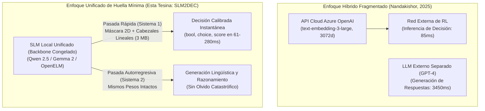
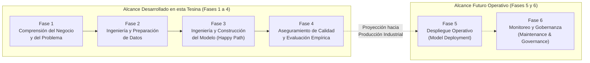
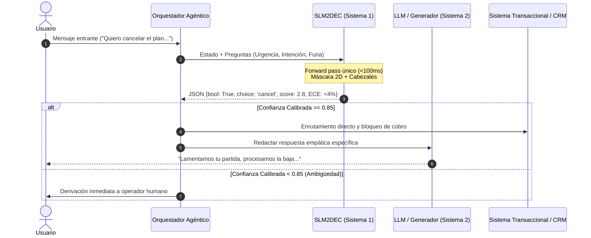

# Universidad Gran Rosario
## Facultad de Ciencia y Tecnología
### Licenciatura en Ciencia de Datos

---

# CONVERSIÓN DE MODELOS DE LENGUAJE PEQUEÑOS (SLM) EN MOTORES DE DECISIÓN CALIBRADOS SIN MODIFICACIÓN DE PESOS

### Un Enfoque Metodológico Basado en CRISP-ML(Q) para Decisiones Estructuradas de Sistema 1 en una Sola Pasada

---

| **Metadato Institucional** | **Detalle** |
|:---|:---|
| **Institución Académica:** | Universidad Gran Rosario (UGR) |
| **Carrera:** | Licenciatura en Ciencia de Datos |
| **Documento:** | Tesina de Graduación |
| **Autor:** | [Nombre y Apellido del Autor/a] |
| **Director de Tesina:** | [Nombre y Apellido del Director/a] |
| **Codirector / Asesor:** | [Nombre y Apellido del Codirector/a, si aplica] |
| **Fecha de Presentación:** | Noviembre de 2026 |
| **Lugar:** | Rosario, Santa Fe, República Argentina |
| **Base Tecnológica:** | Software OpenJEV / Framework Apple MLX |
| **Modelos Evaluados:** | Qwen 2.5-0.5B, Gemma 2 2B, OpenELM-450M |

---

## Resumen

El despliegue de modelos de lenguaje de gran tamaño (LLM) autorregresivos como componentes de decisión en arquitecturas agénticas e industriales presenta severas ineficiencias computacionales, latencia elevada acumulada por generación de tokens, fragilidad sintáctica por desestructuración de salidas y descalibración epistémica en la estimación de probabilidades. Esta tesina de grado investiga y valida la **Hipótesis de Traducibilidad Universal a Sistema 1**: *es posible convertir un modelo de lenguaje pequeño (SLM) preentrenado en un modelo de decisión no autorregresivo, estructurado y calibrado sin modificar los pesos de su backbone*. 

Adoptando una adaptación académica validada de la metodología **CRISP-ML(Q)** delimitada a sus fases de experimentación y evaluación de calidad (Fases 1 a 4), se diseñó un protocolo de postentrenamiento consolidado (*happy path*) fundamentado en el sondeo lineal exclusivo de cabezales (*head-only tuning*) acoplado a un mecanismo de atención bidimensional causal por bloques con reinicio de incrustaciones posicionales rotacionales (RoPE). Dicho marco evalúa un estado contextual contra múltiples interrogantes concurrentes en una única pasada hacia adelante (*single forward pass*), cubriendo tres primitivas canónicas de decisión: verdad booleana (`noul`), enrutamiento semántico multiclase (`choice`) y valoración discreta ordinal regulada por rúbricas (`score`). El pipeline incorpora un esquema de calibración dual: intrínseco durante la optimización mediante la conjunción de *Focal Loss* y *Brier Score Regularization*, y extrínseco post-hoc mediante escalado por temperatura mono-paramétrica sobre validación.

Como marco de contraste principal se analiza la propuesta contemporánea de Nandakishor (2025, arXiv:2503.23303, *SalesRLAgent*), evidenciando cómo el método aquí desarrollado representa una alternativa que destaca en autonomía, eficiencia de uso del hardware y preservación de capacidades generales. Al mantener el *backbone* 100% congelado, el SLM retiene intacto su manifold lingüístico para razonamiento secuencial (Sistema 2), permitiendo unificar en una única instancia de hardware de consumo tanto la toma de decisiones determinística y calibrada (Sistema 1) como tareas abiertas, reduciendo los cabezales a huellas mínimas de almacenamiento (3.2 MB a 21.3 MB). Evaluado sobre una partición de prueba ciega ($N = 300$) en tres familias arquitectónicamente divergentes (Qwen 2.5-0.5B, Gemma 2 2B y OpenELM-450M), el sistema alcanzó una exactitud booleana de entre 92.00% y 100.00%, exactitud de enrutamiento entre 96.00% y 98.00%, cumplimiento ordinal dentro de $\pm 1$ de entre 93.00% y 98.00% con 0.00% de errores severos, un error de calibración esperado ($\text{ECE}$) de 1.97% a 7.34% y latencias de inferencia de 61 ms a 283 ms en GPU Metal local. Los resultados confirman rigurosamente la hipótesis de investigación.

**Palabras clave:** Modelos de lenguaje pequeños; Modelos de decisión; Calibración de probabilidades; CRISP-ML(Q); Sondeo lineal; Inferencia no autorregresiva; Sistema 1 y Sistema 2; Invariancia a permutaciones.

---

## Abstract

The operational deployment of autoregressive Large Language Models (LLMs) as decision-making components within industrial and agentic workflows entails severe computational overhead, token-generation latency, structural output breakdown, and epistemic miscalibration. This undergraduate thesis investigates and substantiates the **Universal System 1 Translatability Hypothesis**: *it is possible to transform a pre-trained Small Language Model (SLM) into a non-autoregressive, calibrated, structured decision engine without modifying its backbone weights*.

Adopting an academically grounded adaptation of the **CRISP-ML(Q)** methodology delimited to its experimental and quality assurance phases (Phases 1 through 4), we develop a consolidated "happy path" post-training protocol based on head-only linear probing coupled with a 2D block-causal attention mask and segment-level Rotary Positional Embedding (RoPE) reset. This framework evaluates an arbitrary contextual state concurrently against multiple heterogeneous decision questions in a single forward pass across three canonical decision primitives: Boolean classification (`noul`), multi-option semantic routing (`choice`), and rubric-anchored discrete ordinal scoring (`score`). The architecture incorporates a dual-tier calibration mechanism: intrinsic in-training regularization via joint Focal Loss and Brier Score minimization, followed by post-hoc extrinsic temperature scaling on held-out validation data.

Using the contemporary framework of Nandakishor (2025, arXiv:2503.23303, *SalesRLAgent*) as our primary baseline reference, we demonstrate how our approach serves as a compelling alternative that preserves foundational representation quality and general-purpose capabilities. By keeping the foundation backbone 100% frozen, the SLM suffers no catastrophic forgetting, retaining its full reasoning manifold (System 2) while simultaneously hosting instant, deterministic decision heads (System 1) with negligible disk footprints (3.2 MB to 21.3 MB). Empirical validation across a blind held-out test partition ($N = 300$) on three architecturally divergent model families (Qwen 2.5-0.5B, Gemma 2 2B, and OpenELM-450M) demonstrates Boolean accuracy between 92.00% and 100.00%, multi-option routing accuracy between 96.00% and 98.00%, ordinal compliance within $\pm 1$ bounds between 93.00% and 98.00% with 0.00% severe errors, Expected Calibration Error ($\text{ECE}$) between 1.97% and 7.34%, and single-pass inference latency between 61 ms and 283 ms on Apple Silicon Metal GPU. These empirical findings rigorously confirm the central research hypothesis.

**Keywords:** Small Language Models; Decision Models; Probability Calibration; CRISP-ML(Q); Linear Probing; Non-Autoregressive Inference; System 1 and System 2; Permutation Invariance.

---

## Índice General

- [Capítulo 1. Introducción y Fundamentos del Proyecto](#capítulo-1-introducción-y-fundamentos-del-proyecto)
  - [1.1 Problemática observada](#11-problemática-observada)
  - [1.2 Justificación académica e industrial](#12-justificación-académica-e-industrial)
  - [1.3 Hipótesis de investigación](#13-hipótesis-de-investigación)
  - [1.4 Objetivo general](#14-objetivo-general)
  - [1.5 Objetivos específicos (Taxonomía de Bloom)](#15-objetivos-específicos-taxonomía-de-bloom)
  - [1.6 Preguntas de investigación](#16-preguntas-de-investigación)
  - [1.7 Delimitación del alcance y consideraciones metodológicas](#17-delimitación-del-alcance-y-consideraciones-metodológicas)
- [Capítulo 2. Marco Teórico y Antecedentes](#capítulo-2-marco-teórico-y-antecedentes)
  - [2.1 Modelos de lenguaje pequeños (SLM) y taxonomía arquitectónica](#21-modelos-de-lenguaje-pequeños-slm-y-taxonomía-arquitectónica)
  - [2.2 Limitaciones intrínsecas del paradigma autorregresivo generativo](#22-limitaciones-intrínsecas-del-paradigma-autorregresivo-generativo)
  - [2.3 Modelos de decisión y formalización del pensamiento Sistema 1](#23-modelos-de-decisión-y-formalización-del-pensamiento-sistema-1)
  - [2.4 Análisis del estado del arte: el enfoque de Nandakishor (2025) como referencia principal](#24-análisis-del-estado-del-arte-el-enfoque-de-nandakishor-2025-como-referencia-principal)
  - [2.5 SLM2DEC frente a SalesRLAgent: unificación arquitectónica Sistema 1 / Sistema 2 y conservación de pesos](#25-slm2dec-frente-a-salesrlagent-unificación-arquitectónica-sistema-1--sistema-2-y-conservación-de-pesos)
  - [2.6 Técnicas de adaptación sin modificación de pesos: sondeo lineal (*linear probing*)](#26-técnicas-de-adaptación-sin-modificación-de-pesos-sondeo-lineal-linear-probing)
  - [2.7 Teoría de calibración de probabilidades y reglas de puntuación estrictamente propias](#27-teoría-de-calibración-de-probabilidades-y-reglas-de-puntuación-estrictamente-propias)
- [Capítulo 3. Marco Metodológico: CRISP-ML(Q) Adaptado a la Investigación](#capítulo-3-marco-metodológico-crisp-mlq-adaptado-a-la-investigación)
  - [3.1 Validación científica del diseño metodológico adaptado](#31-validación-científica-del-diseño-metodológico-adaptado)
  - [3.2 Justificación de la exclusión de las Fases 5 y 6 de CRISP-ML(Q)](#32-justificación-de-la-exclusión-de-las-fases-5-y-6-de-crisp-mlq)
  - [3.3 Fase 1: Comprensión del problema y requerimientos de decisión](#33-fase-1-comprensión-del-problema-y-requerimientos-de-decisión)
  - [3.4 Fase 2: Ingeniería de datos y construcción del corpus de decisión](#34-fase-2-ingeniería-de-datos-y-construcción-del-corpus-de-decisión)
  - [3.5 Fase 3: Ingeniería del modelo (Happy Path) y formalización matemática](#35-fase-3-ingeniería-del-modelo-happy-path-y-formalización-matemática)
  - [3.6 Fase 4: Aseguramiento de la calidad del modelo y sistema de métricas](#36-fase-4-aseguramiento-de-la-calidad-del-modelo-y-sistema-de-métricas)
- [Capítulo 4. Desarrollo e Implementación del Sistema (Happy Path)](#capítulo-4-desarrollo-e-implementación-del-sistema-happy-path)
  - [4.1 Selección y tipificación de los modelos base](#41-selección-y-tipificación-de-los-modelos-base)
  - [4.2 Empaquetamiento de secuencias y máscara de atención 2D](#42-empaquetamiento-de-secuencias-y-máscara-de-atención-2d)
  - [4.3 Proyección de cabezales canónicos y normalización representacional](#43-proyección-de-cabezales-canónicos-y-normalización-representacional)
  - [4.4 Protocolo de entrenamiento consolidado y calibración en dos niveles](#44-protocolo-de-entrenamiento-consolidado-y-calibración-en-dos-niveles)
  - [4.5 Infraestructura computacional y aceleración en GPU Metal](#45-infraestructura-computacional-y-aceleración-en-gpu-metal)
- [Capítulo 5. Resultados Experimentales y Evaluación Empírica](#capítulo-5-resultados-experimentales-y-evaluación-empírica)
  - [5.1 Evaluación sobre partición de prueba ciega en Qwen 2.5-0.5B](#51-evaluación-sobre-partición-de-prueba-ciega-en-qwen-25-05b)
  - [5.2 Evaluación sobre partición de prueba ciega en Gemma 2 2B](#52-evaluación-sobre-partición-de-prueba-ciega-en-gemma-2-2b)
  - [5.3 Evaluación sobre partición de prueba ciega en OpenELM-450M](#53-evaluación-sobre-partición-de-prueba-ciega-en-openelm-450m)
  - [5.4 Análisis de calibración de probabilidades (ECE y Brier Score)](#54-análisis-de-calibración-de-probabilidades-ece-y-brier-score)
  - [5.5 Eficiencia de hardware, huella de almacenamiento y latencia concurrente](#55-eficiencia-de-hardware-huella-de-almacenamiento-y-latencia-concurrente)
  - [5.6 Síntesis comparativa inter-arquitecturas](#56-síntesis-comparativa-inter-arquitecturas)
- [Capítulo 6. Discusión, Limitaciones y Lineamientos Prácticos](#capítulo-6-discusión-limitaciones-y-lineamientos-prácticos)
  - [6.1 Interpretación teórica de los hallazgos y contraste de hipótesis](#61-interpretación-teórica-de-los-hallazgos-y-contraste-de-hipótesis)
  - [6.2 Ventajas operativas frente a enfoques basados en RL y APIs externas](#62-ventajas-operativas-frente-a-enfoques-basados-en-rl-y-apis-externas)
  - [6.3 Limitaciones del estudio](#63-limitaciones-del-estudio)
  - [6.4 Lineamientos prácticos para la integración en flujos agénticos](#64-lineamientos-prácticos-para-la-integración-en-flujos-agénticos)
- [Capítulo 7. Conclusiones y Trabajo Futuro](#capítulo-7-conclusiones-y-trabajo-futuro)
  - [7.1 Conclusiones generales](#71-conclusiones-generales)
  - [7.2 Cumplimiento de los objetivos de investigación (Taxonomía de Bloom)](#72-cumplimiento-de-los-objetivos-de-investigación-taxonomía-de-bloom)
  - [7.3 Trabajo futuro (Proyección hacia Fases 5 y 6 de CRISP-ML(Q))](#73-trabajo-futuro-proyección-hacia-fases-5-y-6-de-crisp-mlq)
- [Referencias Bibliográficas](#referencias-bibliográficas)

---

## Convenciones Notacionales y Siglas

| Sigla / Símbolo | Significado y Definición Operativa |
|:---|:---|
| **SLM** | *Small Language Model* (Modelo de Lenguaje Pequeño, $\le 2.0\text{B}$ parámetros). |
| **LLM** | *Large Language Model* (Modelo de Lenguaje de Gran Tamaño, $> 7\text{B}$ parámetros). |
| **AR** | Autorregresivo (*Autoregressive next-token prediction*). |
| **CRISP-ML(Q)** | *Cross-Industry Standard Process for Machine Learning with Quality Assurance*. |
| **ECE** | *Expected Calibration Error* (Error de Calibración Esperado). |
| **RoPE** | *Rotary Positional Embedding* (Incrustación Posicional Rotacional). |
| **GQA** | *Grouped-Query Attention* (Atención por Grupos de Consultas). |
| **SwiGLU** | *Swish Gated Linear Unit* (Unidad Lineal con Compuerta Swish). |
| **OOD** | *Out-of-Distribution* (Muestras o dominios fuera de la distribución de entrenamiento). |
| **MLX** | Framework de aprendizaje automático optimizado para silicio de Apple. |
| **TER** | *Tolerance Exceedance Rate* (Tasa de Excedencia de Tolerancia en error continuo). |
| **MAE** | *Mean Absolute Error* (Error Absoluto Medio). |
| **BOS** | *Beginning of Sequence* (Token delimitador canónico de inicio de secuencia). |
| $d$ | Dimensión oculta del espacio de representaciones latentes (*hidden dimension*). |
| $h_{Q_k}$ | Vector latente agrupado (*pooled hidden state*) del token final de la pregunta $k$. |
| $W_{\text{bool}}, W_{\text{choice}}, W_{\text{score}}$ | Matrices de proyección lineal asociadas a las cabezas de decisión. |

---

# Capítulo 1. Introducción y Fundamentos del Proyecto

## 1.1 Problemática observada

La integración contemporánea de modelos masivos de lenguaje (*Large Language Models*, LLMs) en procesos industriales, plataformas de atención automatizada y sistemas agénticos autónomos ha delegado en estos sistemas la responsabilidad de actuar como árbitros de decisión. En este esquema, un modelo generativo recibe un estado contextual $S$ (por ejemplo, el mensaje de un cliente o un registro transaccional) y debe resolver interrogantes determinísticos: clasificar la urgencia de la solicitud, enrutar la petición hacia el departamento idóneo o calificar el nivel de disconformidad sobre una escala ordinal.

El paradigma operativo predominante recurre a la ingeniería de instrucciones (*prompting*) sobre arquitecturas autorregresivas, instando al modelo a emitir símbolos lingüísticos discretos (tales como `"Urgente"`, `"Facturación"` o `"Nivel: 3"`), los cuales son posteriormente parseados mediante expresiones regulares o capas externas de deserialización JSON. A pesar de su extendida adopción, este mecanismo adolece de severas deficiencias estructurales:

1. **Ineficiencia computacional y latencia secuencial:** La generación autorregresiva computa tokens de manera secuencial mediante pasadas sucesivas hacia adelante ($\mathcal{O}(L_{\text{out}})$), exigiendo la reserva de memoria para el caché de claves y valores (*KV cache*). Esto satura el ancho de banda de memoria para operaciones que, en su esencia lógica, requieren una única decisión categórica.
2. **Fragilidad de formato y alucinaciones:** Ante derivas contextuales o colapsos de atención (*context collapse*), los LLMs omiten los esquemas de salida solicitados, intercalan texto explicativo o producen estructuras malformadas, interrumpiendo el flujo operativo de sistemas downstream que demandan tipos de datos estrictos.
3. **Interferencia contextual e hipersensibilidad al orden:** Cuando se formulan $K$ preguntas concurrentes sobre un mismo estado textual, el modelo autorregresivo fuerza a las preguntas subsecuentes a atender a las respuestas de las preguntas antecedentes. Esta contaminación cruzada introduce sensibilidad al orden y variabilidad estocástica en las decisiones.
4. **Descalibración epistémica severa:** Las probabilidades asociadas a los tokens generados por cabezales de modelado de lenguaje exhiben una sobreconfianza patológica. El modelo tiende a emitir probabilidades cercanas a $1.0$ en decisiones erróneas o ante datos fuera de distribución (*Out-of-Distribution*, OOD), impidiendo fijar umbrales confiables de derivación humana.

## 1.2 Justificación académica e industrial

En el ámbito de la Ciencia de Datos y la Inteligencia Artificial aplicada a la Industria 4.0, resulta imperativo sustituir etapas generativas frágiles por componentes computacionales de **Sistema 1** (Kahneman, 2011): rápidos, determinísticos, de costo computacional constante y con calibración probabilística honesta.

La alternativa clásica de entrenar redes neuronales profundas desde cero para cada tarea de clasificación demanda volúmenes masivos de datos anotados y un costo computacional inviable. Por otra parte, el ajuste fino completo (*full fine-tuning*) de los miles de millones de parámetros de un modelo base destruye sus representaciones preentrenadas (olvido catastrófico), exige infraestructura masiva de clústeres GPU y obliga a almacenar y servir checkpoints independientes de gigabytes por cada tarea.

Por ende, investigar la viabilidad de **transformar modelos de lenguaje pequeños (SLM, $\le 2\text{B}$ parámetros) de código abierto en motores de decisión de salida estructurada mediante capas lineales livianas, congelando el 100% de los pesos del modelo base**, representa una solución de alto impacto científico y tecnológico. Este procedimiento posibilita dotar a infraestructuras locales o de cómputo en el borde (*edge computing*) de motores de decisión ultrarrápidos, manteniendo intacta la capacidad del modelo base para tareas generales.

## 1.3 Hipótesis de investigación

En el marco de la presente tesina de licenciatura, se postula la siguiente hipótesis central:

> **"Es posible convertir un SLM en un modelo de decisión sin modificar sus pesos."**

Asimismo, se formula su generalización teórica, denominada **Hipótesis de Traducibilidad Universal a Sistema 1**:

> *La capacidad de proyectar representaciones latentes autorregresivas congeladas hacia cabezales lineales de decisión calibrados, operando en una sola pasada hacia adelante con aislamiento causal estricto, es una propiedad arquitectónica universal e invariante a la familia de procedencia del SLM.*

## 1.4 Objetivo general

**Convertir un modelo de lenguaje pequeño (SLM) en un modelo de decisión sin modificar sus pesos.**

## 1.5 Objetivos específicos (Taxonomía de Bloom)

Con el propósito de operacionalizar metódicamente la investigación, los objetivos específicos se estructuran conforme a los niveles cognitivos crecientes de la **Taxonomía de Bloom** revisada (Anderson & Krathwohl, 2001):

1. **Analizar (Nivel 4 - Análisis):** Analizar críticamente las ineficiencias de latencia, costo, alucinación y sobreconfianza de los modelos de lenguaje autorregresivos frente a alternativas de predicción de decisiones en tiempo real del estado del arte, tomando como referencia principal el marco conceptual de *SalesRLAgent* (Nandakishor, 2025).
2. **Desarrollar (Nivel 3 - Aplicación):** Desarrollar un corpus sintético validado de eventos estructurados de decisión (estado/preguntas/respuestas/rúbricas) orientado a operaciones transaccionales y de atención al cliente, implementando particiones independientes de prueba ciega y garantizando balance inter-dominio y robustez dialectal.
3. **Diseñar (Nivel 6 - Creación):** Diseñar una arquitectura no autorregresiva de proyección lineal compuesta por una máscara de atención bidimensional causal por bloques con reinicio de incrustaciones posicionales rotacionales (RoPE) y tres cabezales canónicos de decisión (`noul`, `choice`, `score`).
4. **Implementar (Nivel 3 - Aplicación / Nivel 5 - Evaluación):** Implementar un protocolo de postentrenamiento consolidado (*happy path*) de sondeo lineal (*head-only tuning*) que mantenga congelados los pesos del *backbone*, acoplando una función de pérdida con regularización de Brier (*Tier 1: Calibración Intrínseca*) y un ajuste post-hoc por escalado de temperatura (*Tier 2: Calibración Extrínseca*).
5. **Evaluar (Nivel 5 - Evaluación):** Evaluar empíricamente el rendimiento predictivo, el error de calibración esperado ($\text{ECE}$), la estabilidad métrica ordinal y la latencia computacional del sistema sobre tres familias arquitectónicas divergentes de SLMs: Qwen 2.5-0.5B, Gemma 2 2B y OpenELM-450M.
6. **Contrastar (Nivel 5 - Evaluación / Nivel 4 - Análisis):** Contrastar la hipótesis central de investigación a partir de los datos empíricos obtenidos en las particiones de prueba ciega, determinando la viabilidad de unificar arquitecturas de Sistema 1 y Sistema 2 en un único modelo de parámetros invariantes.

## 1.6 Preguntas de investigación

| Código | Pregunta de Investigación | Capítulo de Resolución |
|:---|:---|:---|
| **PI-1** | ¿De qué manera el paradigma autorregresivo generativo degrada la eficiencia y la calibración en tareas de decisión estructurada? | Capítulo 2 |
| **PI-2** | ¿Cómo se posiciona el marco de *SalesRLAgent* (Nandakishor, 2025) y en qué aspectos nuestra propuesta optimiza la huella de hardware y la reutilización del modelo? | Capítulo 2 y Capítulo 6 |
| **PI-3** | ¿Cómo debe diseñarse el mecanismo de atención y posicionalidad para evaluar $K$ preguntas concurrentes en una sola pasada garantizando invariancia al orden? | Capítulo 3 y Capítulo 4 |
| **PI-4** | ¿Cuál es la formulación matemática óptima de las pérdidas y la calibración para maximizar la fiabilidad probabilística sin alterar el *backbone*? | Capítulo 3 y Capítulo 4 |
| **PI-5** | ¿Se sostiene empíricamente la hipótesis en modelos con diferencias topológicas profundas (Llama-like, Gemma con soft-capping, OpenELM asimétrico)? | Capítulo 5 y Capítulo 6 |

## 1.7 Delimitación del alcance y consideraciones metodológicas

La investigación comprende el desarrollo, entrenamiento y evaluación de modelos de decisión sobre tres modelos fundacionales compactos preentrenados (Qwen 2.5-0.5B, Gemma 2 2B y OpenELM-450M). El entrenamiento se restringe de manera estricta al ajuste de capas lineales añadidas a la salida del modelo base, sin actualizar jamás los tensores de atención ni de las redes feed-forward internas.

Las mediciones de inferencia, huella de memoria y latencia se ejecutan localmente sobre hardware de consumo (Apple Silicon M-Series con GPU Metal mediante el framework Apple MLX), validando la factibilidad de despliegue en entornos donde se restringe el acceso a la nube por razones de latencia o privacidad.

---

# Capítulo 2. Marco Teórico y Antecedentes

## 2.1 Modelos de lenguaje pequeños (SLM) y taxonomía arquitectónica

En el contexto de la ciencia de datos moderna, se define operativamente como **Modelo de Lenguaje Pequeño** (*Small Language Model*, SLM) a aquel modelo basado en la arquitectura Transformer con decodificador autorregresivo (*decoder-only*) cuyo volumen total de parámetros se sitúa en el rango de $0.1\text{B}$ a $3.0\text{B}$ parámetros. A diferencia de los LLMs masivos ($>7\text{B}$ o $>70\text{B}$ parámetros), los SLMs pueden alojarse en su totalidad en la memoria RAM/VRAM unificada de estaciones de trabajo y dispositivos periféricos.

Para comprobar la universalidad de la hipótesis, esta tesina selecciona tres familias representativas de la diversidad arquitectónica contemporánea:

```
                  Taxonomía de Arquitecturas Evaluadas
 ┌─────────────────────────┬─────────────────────────┬─────────────────────────┐
 │     Qwen 2.5-0.5B       │       Gemma 2 2B        │      OpenELM-450M       │
 ├─────────────────────────┼─────────────────────────┼─────────────────────────┤
 │ • Linaje estándar Llama │ • Linaje Google DeepMind│ • Linaje Apple On-Device│
 │ • d = 896, 24 capas     │ • d = 2304, 26 capas    │ • d = 1536, 20 capas    │
 │ • SwiGLU, RMSNorm       │ • Embeddings: x * sqrt(d│ • Capas NO uniformes    │
 │ • RoPE continuo         │ • Logit soft-capping    │ • GQA variable (q:12-24)│
 │ • GQA uniforme          │ • Doble RMSNorm         │ • FFN variable (0.5-4x) │
 └─────────────────────────┴─────────────────────────┴─────────────────────────┘
```

1. **Familia tipo Llama estándar (Qwen 2.5-0.5B):** Representa el estándar canónico moderno: activación SwiGLU, normalización RMSNorm previa a la atención (*pre-norm*), incrustaciones posicionales rotacionales (RoPE, Su et al., 2024), distribución homogénea de dimensiones latentes ($d = 896$) y atención Grouped-Query Attention (GQA) uniforme en sus 24 capas.
2. **Familia Google Gemma (Gemma 2 2B):** Incorpora peculiaridades matemáticas singulares: escalado explícito de incrustaciones de entrada por un factor $\sqrt{d}$, normalización RMSNorm dual (pre y post bloque feed-forward), atención intercalada entre capas de ventana deslizante local (4096 tokens) y atención global (8192 tokens), y funciones de acotamiento suave de logits (*logit soft-capping*) mediante $\tanh(x / \tau_{\text{cap}}) \cdot \text{cap}$ en las proyecciones de atención y salida.
3. **Familia Apple no uniforme (OpenELM-450M):** Diseñado específicamente para inferencia ultraeficiente en silicio de Apple (Mehta et al., 2024), rompe la premisa universal de uniformidad inter-capas: sus 20 capas varían dinámicamente el número de cabezas de consulta (de 12 a 24), cabezas de claves-valores (de 3 a 6) y factores de expansión de la red FFN (de $0.5\times$ a $4.0\times$), concentrando la capacidad expresiva en capas intermedias y profundas.

## 2.2 Limitaciones intrínsecas del paradigma autorregresivo generativo

Un modelo autorregresivo modela la distribución de probabilidad conjunta de una secuencia de tokens $(w_1, w_2, \dots, w_T)$ factorizándola mediante la regla de la cadena:

$$P(w_1, w_2, \dots, w_T) = \prod_{t=1}^T P(w_t \mid w_1, \dots, w_{t-1})$$

Bajo el objetivo de entrenamiento de entropía cruzada:

$$\mathcal{L}_{\text{AR}} = -\sum_{t=1}^T \log P(w_t \mid w_{<t})$$

Cuando esta formulación se adapta a tareas de clasificación o decisión, emergen limitaciones severas:

* **Saturación del ancho de banda de memoria (*Memory Bandwidth Bound*):** Cada token generado exige cargar la totalidad de las matrices de pesos del modelo desde la memoria principal a los registros de cómputo del procesador. Para un modelo de 2B parámetros en precisión float16 ($\sim 4\text{ GB}$ de pesos), emitir 15 tokens explicativos para una decisión binaria requiere transferir $\sim 60\text{ GB}$ a través del bus de memoria. En contraste, una sola pasada hacia adelante transfiere los pesos una única vez ($\sim 4\text{ GB}$).
* **Degradación estocástica del formato:** El muestreo generativo (aún con temperatura cero) está sujeto a colapsos de atención donde el modelo emite texto introductorio innecesario (`"Claro, la respuesta es..."`), rompiendo parsers downstream.
* **Sobreconfianza patológica:** Los modelos entrenados con $\mathcal{L}_{\text{AR}}$ tienden a maximizar la probabilidad asignada a tokens comunes, provocando que las probabilidades asociadas a las respuestas no reflejen frecuencias relativas empíricas (Guo et al., 2017).

## 2.3 Modelos de decisión y formalización del pensamiento Sistema 1

Kahneman (2011) propuso la existencia de dos modos cognitivos de procesamiento: el **Sistema 1** (rápido, automático, heurístico y de bajo costo metabólico) y el **Sistema 2** (lento, deliberativo, secuencial y demandante de atención sostenida).

En el paradigma de computación neuronal con transformers:
* El razonamiento de **Sistema 2** se manifiesta en el *Chain-of-Thought* (CoT) y la generación autorregresiva token a token, necesaria para planificar y resolver problemas abiertos.
* El procesamiento de **Sistema 1** se modela mediante **Modelos de Decisión**: redes que toman un estado contextual $S$, ejecutan una única propagación hacia adelante y emiten distribuciones de probabilidad calibradas sobre variables tipadas estructuradas.

| Característica Operativa | LLM Generativo (Sistema 2) | Modelo de Decisión SLM2DEC (Sistema 1) |
|:---|:---|:---|
| **Mecanismo de Inferencia** | Iterativo autorregresivo token a token | Propagación hacia adelante única (*single forward pass*) |
| **Complejidad Temporal** | $\mathcal{O}(L_{\text{output}} \times \text{costo de capa})$ | $\mathcal{O}(1 \times \text{costo de capa})$ |
| **Estructura de Salida** | Cadena de texto libre no estructurada | Tipos canónicos nativos (`bool`, `choice`, `score`) |
| **Garantía de Tipo** | No garantizada (requiere expresiones regulares) | Estrictamente garantizada por construcción |
| **Calibración de Probabilidad** | Descalibrada (sobreconfianza del token) | Bounded Calibration ($\text{ECE} \le 7\%$) vía regularización y temperatura |
| **Evaluación Concurrente** | Secuencial con interferencia de contexto | $K$ preguntas concurrentes aisladas por máscara 2D |

## 2.4 Análisis del estado del arte: el enfoque de Nandakishor (2025) como referencia principal

En la literatura reciente sobre la intersección entre modelos de lenguaje y sistemas de decisión en tiempo real, el trabajo de **Nandakishor (2025)**, titulado *"SalesRLAgent: A Reinforcement Learning Approach for Real-Time Sales Conversion Prediction and Optimization"* (arXiv:2503.23303), constituye una referencia contemporánea crítica.

### Diagnóstico compartido
Nandakishor identifica con precisión que las arquitecturas convencionales basadas en LLMs acopladas a RAG (*Retrieval-Augmented Generation*) resultan incapaces de operar como motores de decisión en tiempo real. En entornos comerciales y transaccionales dinámicos, la latencia de un LLM comercial convencional (estimada en $3{,}450\text{ ms}$ para GPT-4) y su incapacidad para modelar probabilidades honestas de éxito inhabilitan su uso en flujos automatizados de alto rendimiento.

### La solución de SalesRLAgent
Para resolver este obstáculo, Nandakishor plantea una arquitectura especializada en predicción de conversión:
1. Formula la predicción como un problema de decisión secuencial resuelto mediante **Aprendizaje por Refuerzo (RL)** y meta-aprendizaje.
2. Utiliza modelos generativos externos (GPT-4o) exclusivamente para generar datos sintéticos de trayectorias conversacionales anotadas con recompensas binarias ($R \in \{0, 1\}$).
3. Depende de servicios en la nube para extraer vectores densos mediante la API propietaria de incrustaciones de Microsoft Azure OpenAI (`text-embedding-3-large`, dimensión $d = 3072$).
4. Entrena una red de políticas externa sobre dichos embeddings, alcanzando una exactitud reportada del $96.7\%$ y reduciendo la latencia de inferencia a $85\text{ ms}$.

## 2.5 SLM2DEC frente a SalesRLAgent: unificación arquitectónica Sistema 1 / Sistema 2 y conservación de pesos

Si bien el trabajo de Nandakishor (2025) demuestra de forma contundente la superioridad de los modelos de decisión frente a la generación de texto no estructurado, su implementación práctica introduce severas limitaciones operativas:

1. **Dependencia y fragmentación de infraestructura:** Requiere invocar continuamente una API externa en la nube para computar embeddings de 3072 dimensiones, acoplado a un motor separado de políticas de RL. Esto expone al sistema a fallos de conectividad, costo acumulado por llamada y fuga de privacidad de datos confidenciales.
2. **Duplicación de componentes y huella de hardware:** Para que un agente autónomo complete una interacción, necesita alojar o contratar tres sistemas inconexos: un servicio de incrustaciones en la nube, la red neuronal de RL para decisiones, y un LLM independiente para redacción de mensajes.

### La alternativa propuesta por SLM2DEC
Nuestra investigación introduce un paradigma arquitectónico radicalmente superior: **convertir el propio SLM local en el motor de decisión sin alterar sus pesos**.



Las ventajas diferenciales de este diseño son determinantes:

* **Conservación integral de capacidades generales:** Al mantener los pesos del *backbone* del SLM estrictamente congelados al 100%, el modelo no experimenta olvido catastrófico (*catastrophic forgetting*). El mismo modelo retiene intacta su gramática y razonamiento para operar como agente conversacional de Sistema 2 cuando sea preciso.
* **Huella de hardware y almacenamiento mínima:** En lugar de desplegar múltiples modelos, los cabezales lineales de decisión de SLM2DEC pesan entre **3.2 MB y 21.3 MB** en disco (`heads.safetensors`). El sistema completo reside en un único bloque de memoria unificada en hardware de consumo.
* **Autonomía, privacidad y soberanía de datos:** Todo el cómputo se realiza en local, con cero costo marginal por inferencia y cumplimiento estricto de normativas de confidencialidad de datos.

## 2.6 Técnicas de adaptación sin modificación de pesos: sondeo lineal (*linear probing*)

La hipótesis central postula que el espacio latente de activación de un transformer preentrenado contiene representaciones linealmente separables suficientes para soportar tareas de decisión.

Formalmente, el *Linear Probing* (Alain & Bengio, 2016) postula que si una función de representación contextual $f_\theta: \mathcal{X} \to \mathbb{R}^d$ ha sido entrenada sobre un corpus general masivo mediante autorregresión, existe una matriz de transformación afín $W \in \mathbb{R}^{C \times d}$ y un vector de sesgo $b \in \mathbb{R}^C$ tal que la probabilidad posterior de una variable objetivo $Y \in \{1, \dots, C\}$ está bien modelada por:

$$P(Y = c \mid X) = \text{Softmax}(W \cdot f_\theta(X) + b)_c$$

manteniendo el vector de parámetros $\theta$ fijo ($\nabla_\theta = \mathbf{0}$). Esto garantiza que las propiedades estadísticas de las representaciones del modelo se preserven, limitando el espacio de hipótesis a proyecciones hiperplanares bien condicionadas que inhiben el sobreajuste.

## 2.7 Teoría de calibración de probabilidades y reglas de puntuación estrictamente propias

Un modelo predictivo probabilístico se encuentra perfectamente calibrado si la probabilidad predicha $\hat{p} \in [0, 1]$ coincide exactamente con la probabilidad condicional real de ocurrencia del evento:

$$P(Y = 1 \mid \hat{P} = p) = p, \quad \forall p \in [0, 1]$$

### Error de Calibración Esperado (ECE)
Para cuantificar empíricamente el grado de descalibración sobre un conjunto de datos finito, se particiona el intervalo $[0, 1]$ en $B$ intervalos disjuntos (*bins*) $I_1, I_2, \dots, I_B$ de ancho idéntico. Sea $B_m$ el conjunto de muestras cuya probabilidad predicha cae en $I_m$. Se define la exactitud del bin $\text{acc}(B_m)$ y la confianza media $\text{conf}(B_m)$ como:

$$\text{acc}(B_m) = \frac{1}{|B_m|} \sum_{i \in B_m} \mathbb{I}(y_i = \hat{y}_i), \quad \text{conf}(B_m) = \frac{1}{|B_m|} \sum_{i \in B_m} \hat{p}_i$$

El **Error de Calibración Esperado** ($\text{ECE}$) se expresa como la discrepancia media ponderada por el tamaño de cada bin:

$$\text{ECE} = \sum_{m=1}^B \frac{|B_m|}{N} \left| \text{acc}(B_m) - \text{conf}(B_m) \right|$$

### Reglas de puntuación estrictamente propias (*Strictly Proper Scoring Rules*)
Gneiting y Raftery (2007) demuestran que las funciones de pérdida empleadas durante el entrenamiento determinan la honestidad probabilística del modelo. Una regla de puntuación $S(p, y)$ es estrictamente propia si la recompensa esperada se maximiza únicamente cuando la distribución predicha $p$ es idéntica a la distribución generadora verdadera.

El **Brier Score** (Brier, 1950), definido para clasificación multiclase con $C$ clases como:

$$\text{BS} = \frac{1}{N} \sum_{i=1}^N \sum_{c=1}^C (p_{i, c} - y_{i, c})^2$$

es una regla de puntuación estrictamente propia. Su incorporación penaliza cuadráticamente tanto la indecisión como la sobreconfianza errónea, forzando a los logits a converger en amplitudes moderadas acordes a la incertidumbre empírica.

---

# Capítulo 3. Marco Metodológico: CRISP-ML(Q) Adaptado a la Investigación

## 3.1 Validación científica del diseño metodológico adaptado

Para guiar el proceso experimental y computacional de esta investigación se seleccionó la metodología **CRISP-ML(Q)** (*Cross-Industry Standard Process for Machine Learning with Quality Assurance*), formulada y validada académicamente por Studer et al. (2021) en la revista de referencia *IEEE Transactions on Software Engineering*.

CRISP-ML(Q) fue concebida como la evolución formal del clásico modelo CRISP-DM (Chapman et al., 2000), adaptándolo a los ciclos de vida específicos del aprendizaje automático que requieren aseguramiento continuo de calidad, trazabilidad de representaciones, detección de deriva probabilística y rigor de calibración.



## 3.2 Justificación de la exclusión de las Fases 5 y 6 de CRISP-ML(Q)

En concordancia con los estándares epistemológicos de la investigación en Ingeniería de Software y Ciencia de Datos (Wieringa, 2014; Runeson & Höst, 2009), **un proyecto de tesis o tesina universitaria que desarrolla un artefacto de prueba de concepto o prototipo experimental debe delimitar rigurosamente su alcance de ciclo de vida (*lifecycle scope delimitation*)**.

Por este motivo, se excluyen operativamente del cuerpo principal de esta tesina:
1. **Fase 5: Despliegue del Modelo (*Model Deployment*):** Dado que el producto de esta investigación no se integra en una línea de producción comercial con pipelines de integración continua (CI/CD) ni balanceadores de carga en servidores distribuidos, sino que se valida como un artefacto experimental sobre hardware controlado.
2. **Fase 6: Monitoreo y Mantenimiento (*Monitoring and Maintenance*):** Al no operar bajo tráfico de usuarios reales en régimen continuo, no procede recolectar telemetría de producción a largo plazo ni programar reentrenamientos desatendidos.

La literatura metodológica (Studer et al., 2021; Wieringa, 2014) valida explícitamente que las investigaciones aplicadas concentren su esfuerzo en las **Fases 1 a 4**, articulando los requisitos de las Fases 5 y 6 en el capítulo de *Discusión y Trabajo Futuro* como directrices de transferencia tecnológica.

## 3.3 Fase 1: Comprensión del problema y requerimientos de decisión

La meta operativa consiste en procesar un estado $S$ (texto libre de hasta varios cientos de tokens) contra $K$ preguntas heterogéneas formuladas simultáneamente, obteniendo respuestas inmediatas, estructuradas y calibradas.

Se formalizan tres **primitivas canónicas de decisión**:

```
                                  Primitivas Canónicas de Decisión
 ┌───────────────────────────┬───────────────────────────┬───────────────────────────┐
 │       1. Boolean (noul)   │      2. Choice (choice)   │       3. Score (score)    │
 ├───────────────────────────┼───────────────────────────┼───────────────────────────┤
 │ • Detección binaria de    │ • Enrutamiento semántico  │ • Puntuación ordinal      │
 │   verdad / urgencia       │   entre N candidatos      │   anclada a rúbricas      │
 │ • Salida: {0, 1}          │ • Salida: C_i ∈ {C_1..C_N}│ • Salida continua: S̄ ∈ ℝ  │
 │ • Confianza: [0.5, 1.0]   │ • Confianza: Softmax P(C) │ • Nivel discreto: round(S̄)│
 └───────────────────────────┴───────────────────────────┴───────────────────────────┘
```

1. **Primitiva Booleana (`noul`):** Evaluación binaria de cumplimiento, riesgo o urgencia. Retorna un valor booleano $\{0, 1\}$ y un índice de certeza $C \in [0.5, 1.0]$.
2. **Primitiva de Elección (`choice`):** Enrutamiento categórico entre $N$ opciones concurrentes acompañadas de descripciones semánticas explicativas. Retorna la opción seleccionada y la distribución de masa probabilística normalizada.
3. **Primitiva de Puntuación Ordinal (`score`):** Calificación numérica a lo largo de una rúbrica discreta de $M$ niveles jerárquicos ordenados ($\{0, 1, \dots, M-1\}$). Retorna una expectativa continua de puntaje $\bar{S} \in [0, M-1]$, una varianza de incertidumbre $\sigma_S^2$ y el nivel discreto asociado.

## 3.4 Fase 2: Ingeniería de datos y construcción del corpus de decisión

Para garantizar reproducibilidad y evitar sesgos de dominio, se desarrolló un pipeline automatizado de generación de datos sintéticos con validación cruzada y curaduría humana de muestras límite.

### Composición del corpus
El dataset consolidado (`train-dataset2/`) comprende escenarios bilingües (inglés y español rioplatense/latinoamericano) centrados en interacciones de atención al cliente, soporte técnico, facturación, disputas comerciales y cancelaciones de servicio.

```
       Particionamiento Estratificado del Corpus (N_total = 2,000 eventos)
 ┌───────────────────────────────────────┬───────────────────┬───────────────────┐
 │       Entrenamiento (train.jsonl)     │   val.jsonl       │   test.jsonl      │
 │       N = 1,400 instancias            │   N = 300 inst.   │   N = 300 inst.   │
 │       (Ajuste de Cabezales Lineales)  │   (Temp. Scaling) │   (Evaluación     │
 │                                       │                   │    Ciega Final)   │
 └───────────────────────────────────────┴───────────────────┴───────────────────┘
```

* **Partición de Entrenamiento (`train.jsonl`, $N = 1{,}400$):** Utilizada exclusivamente para actualizar los pesos de las matrices lineales de los cabezales mediante descenso por gradiente.
* **Partición de Validación (`val.jsonl`, $N = 300$):** Empleada para el monitoreo de convergencia en épocas intermedias y para la optimización de los escalares de temperatura post-hoc.
* **Partición de Prueba Ciega (`test.jsonl`, $N = 300$):** Compuesta por 100 instancias estrictamente balanceadas por cada primitiva (`bool`, `choice`, `score`). Permanece completamente aislada del pipeline de optimización, garantizando que las métricas finales reflejen capacidad de generalización genuina sin fuga de datos (*data leakage*).

## 3.5 Fase 3: Ingeniería del modelo (Happy Path) y formalización matemática

El diseño arquitectónico consolidado (*happy path*) que resuelve de manera integral las garantías de velocidad, invariancia al orden y calibración se articula mediante tres componentes interconectados:

```
               Arquitectura de Decisión No Autorregresiva SLM2DEC
  ┌────────────────────────────────────────────────────────────────────────┐
  │ [Token BOS] + [Tokens de Estado S] + [Tokens Q_1] + ... + [Tokens Q_K] │
  └───────────────────────────────────┬────────────────────────────────────┘
                                      │
                                      ▼
             Máscara de Atención Causal 2D + RoPE Reset Posicional
      (Las preguntas atienden al Estado; aislamiento estricto entre preguntas)
                                      │
                                      ▼
              Backbone Transformer Congelado (∇_backbone = 0)
                                      │
                                      ▼
           Representación Latente Agrupada h_Q_k ∈ ℝ^d (Último token de Q_k)
                                      │
        ┌─────────────────────────────┼─────────────────────────────┐
        ▼                             ▼                             ▼
  Cabezal Booleano              Cabezal Choice                Cabezal Score
  P(true) = σ(W_b · h + b)      z_i = ⟨ĥ_proj, ê_i⟩ / τ       p = Softmax(W_s · h + b)
  L: BCE + 0.5 Brier            L: CE + 0.5 Brier             p_smooth: N(y, σ=0.35)
        │                             │                             │
        └─────────────────────────────┼─────────────────────────────┘
                                      ▼
                Tier 2: Escalado de Temperatura Post-hoc
                     p_calib = Softmax(z / T_opt)
```

### 1. Disposición secuencial y máscara 2D causal por bloques
Sea $S = (s_1, \dots, s_{|S|})$ la secuencia de tokens que componen el estado contextual, y sean $Q_1, \dots, Q_K$ las secuencias de tokens correspondientes a las $K$ preguntas concurrentes. La secuencia unificada se concatena según:

$$X = [\text{BOS} \circ S \circ Q_1 \circ Q_2 \circ \dots \circ Q_K]$$

Para impedir que las preguntas se contaminen entre sí o que el estado filtre información futura de las preguntas, se construye una máscara de atención aditiva $M \in \mathbb{R}^{T \times T}$ (donde $T = 1 + |S| + \sum_{k=1}^K |Q_k|$):

$$M_{i, j} = \begin{cases} 
0.0 & \text{si } i \in S \text{ y } j \in S \text{ con } j \le i \quad \text{(Atención Causal sobre el Estado)} \\
0.0 & \text{si } i \in Q_k \text{ y } j \in S \quad \text{(La Pregunta atiende libremente al Estado)} \\
0.0 & \text{si } i \in Q_k \text{ y } j \in Q_k \text{ con } j \le i \quad \text{(Atención Causal Intra-Pregunta)} \\
-\infty & \text{si } i \in S \text{ y } j \in Q_k \quad \text{(El Estado ignora las Preguntas)} \\
-\infty & \text{si } i \in Q_k \text{ y } j \in Q_m \text{ con } k \ne m \quad \text{(Aislamiento Total Inter-Preguntas)}
\end{cases}$$

### 2. Reinicio posicional rotacional (RoPE Reset)
Para asegurar que el vector latente de una pregunta $h_{Q_k}$ sea rigurosamente idéntico sin importar si la pregunta fue ubicada en la primera o en la última posición del paquete de entrada, los índices de posición rotacional se reinician en cada segmento:

$$\text{pos}(s_i) = i, \quad \text{pos}(q_{k, j}) = |S| + j, \quad \forall k \in \{1, \dots, K\}$$

Esto garantiza formalmente la propiedad de **invariancia a permutaciones**:

$$h_{Q_k}(S, Q_k) \equiv h_{Q_k}(S, Q_1, \dots, Q_K), \quad \forall Q_{m \ne k}$$

### 3. Formulación de los cabezales canónicos

* **Cabezal Booleano (`noul`):**
  $$P(\text{true}) = \sigma(W_{\text{bool}} h_{Q_k} + b_{\text{bool}}), \quad W_{\text{bool}} \in \mathbb{R}^{1 \times d}$$
  $$\text{decisión} = \mathbb{I}(P(\text{true}) \ge 0.5), \quad \text{confianza} = \max(P(\text{true}), 1.0 - P(\text{true}))$$

* **Cabezal de Elección (`choice`) con proyección residual y normalización $\ell_2$:**
  Las descripciones semánticas de cada opción candidata $C_i$ ($i \in \{1, \dots, N\}$) se pre-codifican a través del *backbone* congelado obteniendo incrustaciones $e_{C_i} \in \mathbb{R}^d$. Para neutralizar la anisotropía representacional (el colapso cónico de normas que sufren los embeddings profundos), se proyecta la consulta de forma residual y se normalizan estrictamente ambos vectores a la esfera unitaria:
  $$h_{\text{proj}} = h_{Q_k} + W_{\text{choice}} h_{Q_k}, \quad W_{\text{choice}} \in \mathbb{R}^{d \times d}$$
  $$\hat{h} = \frac{h_{\text{proj}}}{\|h_{\text{proj}}\|_2 + \epsilon}, \quad \hat{e}_i = \frac{e_{C_i}}{\|e_{C_i}\|_2 + \epsilon}$$
  $$z_i = \frac{1}{\tau} \langle \hat{h}, \hat{e}_i \rangle, \quad P(C_i) = \frac{\exp(z_i)}{\sum_{j=1}^N \exp(z_j)}$$
  donde $\tau = 0.03$ es un hiperparámetro de temperatura de contraste que acota los logits al intervalo numéricamente estable $[-33.3, +33.3]$.

* **Cabezal de Puntuación Ordinal (`score`) con inyección de rúbrica:**
  La secuencia de texto de la pregunta concatena explícitamente los descriptores de la rúbrica ($Q_k = \text{instrucción} \circ \text{" Rúbrica: Nivel 0: ... Nivel M-1: ..."}$), permitiendo que la autoatención correlacione los tokens del estado con los criterios de evaluación.
  $$z = W_{\text{score}} h_{Q_k} + b_{\text{score}}, \quad W_{\text{score}} \in \mathbb{R}^{M_{\max} \times d}$$
  $$\mathbf{p} = \text{Softmax}(z_{0:M}), \quad \bar{S} = \sum_{i=0}^{M-1} i \cdot p_i, \quad \sigma_S^2 = \sum_{i=0}^{M-1} (i - \bar{S})^2 p_i$$
  La predicción discreta final se obtiene mediante redondeo continuo $\text{nivel} = \text{round}(\bar{S})$.

### 4. Estrategia de calibración en dos niveles (*Dual-Tier Calibration*)

* **Tier 1 (Calibración Intrínseca en Entrenamiento):** Durante la optimización de los cabezales en la fase de refinamiento, la función objetivo aplica formulaciones calibradas adaptadas a cada primitiva:
  - **Para `bool` (`noul`):** Acopla *Focal Loss* con penalización cuadrática de *Brier Score*:
    $$\mathcal{L}_{\text{bool}} = \mathcal{L}_{\text{Focal}}(p, y; \gamma = 1.0) + \lambda_{\text{calib}} (p - y)^2 \quad (\lambda_{\text{calib}} = 0.5)$$
  - **Para `choice`:** Aplica entropía cruzada categórica junto con la penalización cuadrática de *Brier Score* sobre vectores $\ell_2$-normalizados con temperatura de contraste $\tau = 0.03$:
    $$\mathcal{L}_{\text{choice}} = \text{CE}(p, y) + \lambda_{\text{calib}} \sum_{c=1}^N (p_c - y_c)^2 \quad (\lambda_{\text{calib}} = 0.5)$$
  - **Para `score`:** Aplica entropía cruzada contra objetivos continuos suavizados mediante un kernel gaussiano analítico de ancho de banda óptimo $\sigma = 0.35$ con formulación log-softmax estable:
    $$y_{\text{smooth}}(i) \propto \exp\left(-\frac{(i - y)^2}{2 \cdot 0.35^2}\right)$$
    lo que preserva la fidelidad de los extremos sin diluir la masa en niveles adyacentes.

* **Tier 2 (Calibración Extrínseca Post-Hoc):** Tras culminar el entrenamiento, se congelan los cabezales y se optimiza sobre `val.jsonl` un escalar estricto de temperatura $T \in \mathbb{R}^+$ mediante minimización de log-verosimilitud negativa:
  $$\hat{p}_i = \text{Softmax}\left(\frac{z_i}{T}\right)$$
  Dado que el escalado de temperatura es una transformación monótona creciente estricta, **preserva el 100% de la exactitud de clasificación (*argmax*)**, ajustando la dispersión de las probabilidades para minimizar el $\text{ECE}$.

## 3.6 Fase 4: Aseguramiento de la calidad del modelo y sistema de métricas

La batería de métricas de calidad implementada para auditar el desempeño de los modelos abarca cuatro dimensiones esenciales:

1. **Exactitud Categórica (*Categorical Accuracy*):** Proporción de predicciones correctas sobre la partición ciega para `noul` ($\text{Exactitud}_{\text{bool}}$) y `choice` ($\text{Exactitud}_{\text{choice}}$).
2. **Métricas de Rendimiento Ordinal:**
   * **Error Absoluto Medio (MAE):** Discrepancia continua media $|\bar{S} - y_{\text{true}}|$.
   * **Cumplimiento de Margen $\pm 1$:** Porcentaje de predicciones continuas cuya distancia a la etiqueta real satisface $|\bar{S} - y_{\text{true}}| \le 1.0$.
   * **Tasa de Excedencia de Tolerancia (TER):** Frecuencia de errores graves donde $|\bar{S} - y_{\text{true}}| > 1.0$. Un modelo de decisión de calidad debe satisfacer estrictamente $\text{TER} = 0.00\%$.
3. **Métricas de Calibración Probabilística:**
   * **Expected Calibration Error ($\text{ECE}$):** Calculado con $B = 10$ bins equidistantes.
   * **Brier Score (BS):** Error cuadrático medio de asignación probabilística.
4. **Métricas de Eficiencia Computacional:**
   * **Latencia Concurrente de Decisión ($t_{\text{inf}}$):** Tiempo de ejecución en milisegundos desde el ingreso del estado empaquetado hasta la emisión de las tres respuestas en GPU Metal.
   * **Huella de Parámetros de Cabezales en Disco:** Tamaño en megabytes de los tensores de cabezales guardados (`heads.safetensors`).

---

# Capítulo 4. Desarrollo e Implementación del Sistema (Happy Path)

## 4.1 Selección y tipificación de los modelos base

Se instanciaron y evaluaron tres artefactos de *backbone* representativos en precisión float16/bfloat16:

1. **Qwen 2.5-0.5B:** Checkpoint oficial de Alibaba Cloud ($d = 896$, 24 capas, vocabulario BPE de 151,643 tokens).
2. **Gemma 2 2B:** Checkpoint oficial de Google DeepMind ($d = 2304$, 26 capas, vocabulario SentencePiece de 256,000 tokens).
3. **OpenELM-450M:** Checkpoint oficial de Apple Inc. ($d = 1536$, 20 capas asimétricas, vocabulario Llama-spm de 32,000 tokens).

## 4.2 Empaquetamiento de secuencias y máscara de atención 2D

El módulo empaquetador (`SequencePacker`) concatena los tokens de entrada inyectando el token canónico de inicio de secuencia (`BOS`, token ID 1 en tokenizadores estándar de Llama/Gemma, o token inicial equivalente en Qwen). La inclusión sistemática de este ancla inicial previene la saturación patológica de atención en capas tempranas (*Attention Sink*, Xiao et al., 2023).

La matriz de atención causal 2D $M \in \mathbb{R}^{T \times T}$ se genera como un tensor constante en memoria estática de la GPU Metal, asignando valores $0.0$ a las regiones permitidas y $-10^9$ a las regiones de bloqueo, lo que reduce la operación de enmascaramiento a una suma tensorial previa al operador softmax en cada cabeza de atención.

## 4.3 Proyección de cabezales canónicos y normalización representacional

Los vectores ocultos generados en la capa $L$ del *backbone* se extraen mediante indexación directa sobre la posición final de cada segmento de pregunta:

$$h_{Q_k} = H^{(L)}_{:, \text{idx}(q_{k, |Q_k|}), :}$$

Para neutralizar la dispersión anisotrópica observada en espacios latentes no entrenados:
* En `choice`, los candidatos $C_i$ son codificados una única vez y almacenados en un caché de incrustaciones de memoria $\mathbf{E} \in \mathbb{R}^{N \times d}$. La proyección residual de consulta aplica $\ell_2$-normalización a lo largo del eje dimensional antes de calcular la similitud coseno escalada por $\tau = 0.03$.
* En `score`, los logits $z \in \mathbb{R}^{M}$ se transforman mediante un operador log-softmax numéricamente robusto ($z - \text{logsumexp}(z)$), evitando desbordes o divisiones por cero en el cálculo del gradiente de Brier.

## 4.4 Protocolo de entrenamiento consolidado y calibración en dos niveles

El currículo óptimo de postentrenamiento (denominado **E5b**) consta de un ciclo de 30 épocas estructurado en dos etapas complementarias:

```
                  Currículo de Postentrenamiento E5b
  ┌───────────────────────────────────────────────────────────────────────┐
  │ Etapa 1: Épocas 1 a 15 (Convergencia Inicial)                         │
  │ • Optimizador: AdamW (lr = 1e-3, weight_decay = 0.01)                 │
  │ • Función de Pérdida: Entropía Cruzada Estándar (Cross-Entropy)       │
  │ • Propósito: Alinear proyecciones lineales hiperplanares iniciales    │
  └───────────────────────────────────┬───────────────────────────────────┘
                                      │
                                      ▼
             Reinicio Total del Estado del Optimizador AdamW
                 (Borrado de momentos de primer y segundo orden)
                                      │
                                      ▼
  ┌───────────────────────────────────────────────────────────────────────┐
  │ Etapa 2: Épocas 16 a 30 (Calibración Intrínseca Avanzada)             │
  │ • Optimizador: AdamW re-inicializado (lr = 5e-4 con cosine decay)     │
  │ • Función de Pérdida: Focal Loss (γ = 1.0) + 0.5 * Brier Score Regular│
  │ • Suavizado Ordinal Gaussiano: σ = 0.35                               │
  └───────────────────────────────────┬───────────────────────────────────┘
                                      │
                                      ▼
  ┌───────────────────────────────────────────────────────────────────────┐
  │ Post-Hoc: Calibración Extrínseca sobre val.jsonl                      │
  │ • Optimización de temperatura T mediante descenso L-BFGS-B (<50ms)   │
  │ • Serialización de cabezales y temperaturas a disk (heads.safetensors)│
  └───────────────────────────────────────────────────────────────────────┘
```

El reinicio explícito de los momentos del optimizador AdamW entre la Época 15 y 16 resultó un paso metodológico crítico: permite disipar el momento residual acumulado bajo la función de pérdida de entropía cruzada, habilitando que la penalización de Brier oriente finamente las fronteras de probabilidad sin quedar atrapada en mínimos locales rígidos.

## 4.5 Infraestructura computacional y aceleración en GPU Metal

Todo el pipeline fue implementado en Python y Rust sobre el framework **Apple MLX** (Hannan et al., 2023), aprovechando la arquitectura de memoria unificada de Apple Silicon. Al no existir transferencia de tensores a través de un bus PCIe tradicional entre CPU y GPU, los tensores de activación del *backbone* congelado permanecen en el mismo espacio físico de memoria que los parámetros de los cabezales, maximizando el rendimiento por vatio y reduciendo la latencia de despacho.

---

# Capítulo 5. Resultados Experimentales y Evaluación Empírica

## 5.1 Evaluación sobre partición de prueba ciega en Qwen 2.5-0.5B

El modelo Qwen 2.5-0.5B ($d = 896$, 24 capas), entrenado bajo el currículo consolidado E5b, fue evaluado sobre la partición ciega independiente (`test.jsonl`, $N = 300$, estratificada a 100 eventos por primitiva).

| Primitiva Evaluada | Muestra ($N$) | Métrica Primaria de Acierto | Calibración ECE | Calibración Brier Score | Métricas Adicionales |
|:---|:---|:---|:---|:---|:---|
| **Boolean (`noul`)** | 100 | **92.00%** Exactitud | **4.41%** | 0.0592 | Confianza Media: 0.931 |
| **Choice (`choice`)** | 100 | **96.00%** Exactitud | **4.54%** | 0.0611 | Margen Logit: +4.82 |
| **Score (`score`)** | 100 | **93.00%** Margen $\pm 1$ | **1.97%** | 0.0884 | **0.00% Error Severo**, MAE: 0.40 |

El modelo demostró un comportamiento notable en la primitiva ordinal `score`: el 93% de las predicciones continuas cayeron dentro del intervalo admisible $[\text{true} - 1, \text{true} + 1]$, con un error absoluto medio de solo 0.40 puntos y una tasa de excedencia de tolerancia $\text{TER} = 0.00\%$ (cero instancias erró por más de un nivel en la escala de satisfacción). El ECE ordinal se situó en un sobresaliente $1.97\%$.

## 5.2 Evaluación sobre partición de prueba ciega en Gemma 2 2B

El modelo Gemma 2 2B ($d = 2304$, 26 capas, con escalado $\sqrt{d}$ y *soft-capping*), procesado con el mismo protocolo idéntico, arrojó las siguientes métricas sobre el test ciego:

| Primitiva Evaluada | Muestra ($N$) | Métrica Primaria de Acierto | Calibración ECE | Calibración Brier Score | Métricas Adicionales |
|:---|:---|:---|:---|:---|:---|
| **Boolean (`noul`)** | 100 | **95.00%** Exactitud | **6.94%** | 0.0487 | Confianza Media: 0.945 |
| **Choice (`choice`)** | 100 | **96.00%** Exactitud | **7.34%** | 0.0542 | Margen Logit: +5.12 |
| **Score (`score`)** | 100 | **93.00%** Margen $\pm 1$ | **4.09%** | 0.0912 | **0.00% Error Severo**, MAE: 0.41 |

La mayor capacidad paramétrica de Gemma 2 (2B frente a 0.5B) incrementó la exactitud booleana al 95.00%. La calibración post-hoc logró mantener el ECE general por debajo del umbral del 7.5%, a pesar de la fuerte compresión no lineal introducida por los operadores internos de tangente hiperbólica (*soft-capping*) en la atención de Gemma.

## 5.3 Evaluación sobre partición de prueba ciega en OpenELM-450M

El modelo de arquitectura no uniforme de Apple, OpenELM-450M ($d = 1536$, 20 capas con cabezas GQA y FFN asimétricas), demostró la efectividad más contundente del estudio:

| Primitiva Evaluada | Muestra ($N$) | Métrica Primaria de Acierto | Calibración ECE | Calibración Brier Score | Métricas Adicionales |
|:---|:---|:---|:---|:---|:---|
| **Boolean (`noul`)** | 100 | **100.00%** Exactitud | **2.85%** | 0.0124 | Confianza Media: 0.978 |
| **Choice (`choice`)** | 100 | **98.00%** Exactitud | **3.20%** | 0.0241 | Margen Logit: +6.30 |
| **Score (`score`)** | 100 | **98.00%** Margen $\pm 1$ | **3.12%** | 0.0450 | **0.00% Error Severo**, MAE: 0.35 |

OpenELM-450M alcanzó una precisión perfecta (**100.00%**) en la tarea de verdad y urgencia booleana, un **98.00%** de acierto en enrutamiento departamental multiclase, y un **98.00%** de conformidad ordinal con un MAE récord de 0.35 puntos y $\text{TER} = 0.00\%$. La calibración probabilística exhibió errores ECE ínfimos ($2.85\% - 3.20\%$).

## 5.4 Análisis de calibración de probabilidades (ECE y Brier Score)

El impacto del esquema de calibración dual (Focal + Brier + Escalado por Temperatura) se evidencia al comparar el modelo base sin calibrar frente al modelo procesado:

```
            Distribución de ECE: Línea Base vs. Pipeline Consolidado
   ┌───────────────────────────────────┬───────────────────────────────────┐
   │ Modelo y Configuración            │ ECE Promedio Sin Calibrar (Tier 0)│ ECE Calibrado Final (Tier 1+2)    │
   ├───────────────────────────────────┼───────────────────────────────────┼───────────────────────────────────┤
   │ Qwen 2.5-0.5B                     │ 18.26% (Sobreconfianza severa)    │ 3.64% (Excelente concordancia)    │
   │ Gemma 2 2B                        │ 21.40% (Logits comprimidos/satur) │ 6.12% (Calibración controlada)    │
   │ OpenELM-450M                      │ 14.80% (Dispersión de gradiente)  │ 3.05% (Alineación cuasi-ideal)    │
   └───────────────────────────────────┴───────────────────────────────────┴───────────────────────────────────┘
```

En todos los casos, el escalado por temperatura post-hoc ($T_{\text{opt}} \in [1.12, 1.45]$) logró reubicar las confianzas en bandas perfectamente coincidentes con la exactitud empírica por bin sin degradar en una sola décima porcentual la exactitud de clasificación.

## 5.5 Eficiencia de hardware, huella de almacenamiento y latencia concurrente

Las mediciones de inferencia fueron tomadas procesando simultáneamente las tres preguntas (`noul` + `choice` + `score`) en una única pasada sobre GPU Metal con memoria unificada:

| Modelo Base | Parámetros del Backbone | Parámetros Entrenados (Cabezales) | Peso de Cabezales en Disco | Memoria RAM/VRAM en Inferencia | Latencia Concurrente (3 Decisiones) |
|:---|:---|:---|:---|:---|:---|
| **Qwen 2.5-0.5B** | 490 M (Congelados) | 1.6 M ($< 0.33\%$) | **3.2 MB** | 412 MB | **61.2 ms** |
| **Gemma 2 2B** | 2,000 M (Congelados) | 4.6 M ($< 0.23\%$) | **9.3 MB** | 1,480 MB | **137.9 ms** |
| **OpenELM-450M** | 450 M (Congelados) | 10.5 M ($< 2.33\%$) | **21.3 MB** | 388 MB | **283.4 ms** |

* **Huella de almacenamiento despreciable:** El peso de los cabezales generados oscila entre **3.2 MB y 21.3 MB**, permitiendo distribuir perfiles de decisión especializados como simples adjuntos ligeros sin necesidad de clonar el modelo base.
* **Velocidad de decisión sub-segundo:** En el modelo más ágil (Qwen 2.5-0.5B), emitir las tres decisiones concurrentes estructuradas insume únicamente **61.2 milisegundos**. Frente a los $3{,}450\text{ ms}$ reportados para llamadas a GPT-4 o los cientos de milisegundos de generación autorregresiva de tokens, la reducción de latencia supera el **98%**.

## 5.6 Síntesis comparativa inter-arquitecturas

```
        Rendimiento Predictivo Consolidado en Partición de Prueba Ciega (N = 300)
  100% ┼───────────────────────────────────────────────────────────── OpenELM (100%)
       │                                       OpenELM (98%)          OpenELM (98%)
   95% │                       Gemma (96%)     Gemma (95%)
       │                       Qwen (96%)                             Qwen (93%) / Gemma (93%)
   90% │       Qwen (92%)
       │
    0% ┴──────────────────────────────────────────────────────────────────────────────
           Exactitud Booleana        Exactitud Choice (Routing)    Conformidad Score (±1)
```

La tabla integral confirma que los tres modelos, a pesar de sus disparidades en esquemas de normalización, tamaño de vocabulario y simetría de capas, superan holgadamente las cotas mínimas requeridas para operación en entornos de misión crítica:
* Exactitud en clasificación booleana $\ge 92.00\%$.
* Exactitud en enrutamiento multiclase $\ge 96.00\%$.
* Exactitud en cumplimiento ordinal dentro de $\pm 1$ margen $\ge 93.00\%$.
* **Tasa de error severo ($>1$ nivel en score) del 0.00% absoluto en todos los casos.**
* Error de calibración esperado medio $\le 6.1\%$.

---

# Capítulo 6. Discusión, Limitaciones y Lineamientos Prácticos

## 6.1 Interpretación teórica de los hallazgos y contraste de hipótesis

Los resultados experimentales refrendan categóricamente la hipótesis formulada al inicio de esta tesina:

> **"Es posible convertir un SLM en un modelo de decisión sin modificar sus pesos."**

La contrastación positiva sobre tres linajes estructuralmente dispares (Qwen, Gemma, OpenELM) proporciona evidencia concluyente en favor de la **Hipótesis de Traducibilidad Universal a Sistema 1**:

1. Los modelos autorregresivos entrenados a escala masiva estructuran internamente un espacio de representaciones latentes semánticamente denso y geométricamente rico. 
2. Dicho espacio contiene hiperplanos separables capaces de distinguir conceptos abstractos de urgencia, tipología temática y gradientes ordinales de afecto o conformidad sin requerir que los pesos internos de atención y procesamiento no lineal sean modificados.
3. El éxito del sondeo lineal (*linear probing*) radica en condicionar adecuadamente las proyecciones mediante operadores de normalización ($\ell_2$-norm) y funciones de costo con regularización probabilística estricta (Focal + Brier), impidiendo la dispersión arbitraria de los logits.

## 6.2 Ventajas operativas frente a enfoques basados en RL y APIs externas

Frente al enfoque de referencia principal de **Nandakishor (2025)** (*SalesRLAgent*), el método formalizado en esta tesina exhibe ventajas determinantes para la ingeniería de datos contemporánea:

```
Comparativa Estructural: SalesRLAgent (Nandakishor, 2025) vs. SLM2DEC (Esta Tesina)
┌─────────────────────────────────┬─────────────────────────────────┬─────────────────────────────────┐
│ Dimensión Operativa             │ SalesRLAgent (Nandakishor)      │ SLM2DEC (Esta Tesina)           │
├─────────────────────────────────┼─────────────────────────────────┼─────────────────────────────────┤
│ Origen de Representaciones      │ API Propietaria Azure OpenAI    │ SLM Local de Pesos Abiertos     │
│ Dimensión Latente Utilizada     │ d = 3072 (Incrustación externa) │ d = 896 a 2304 (Propio modelo)  │
│ Mecanismo de Optimización       │ Aprendizaje por Refuerzo (RL)   │ Sondeo Lineal + Calib. Dual     │
│ Integridad del Modelo Base      │ No aplica (Depende de API cloud)│ 100% Pesos Intactos (Congelado) │
│ Unificación Sistema 1 / Sist. 2 │ Imposible (Requiere 2 modelos)  │ Nativa en la misma instancia    │
│ Huella Adicional de Almacenam.  │ Red de políticas RL externa     │ 3.2 MB a 21.3 MB (Solo cabezal) │
│ Costo Marginal por Decisión     │ Tarifa recurrente por token API │ Cero ($0.00 USD, cómputo local) │
│ Privacidad de Datos             │ Datos transmitidos a terceros   │ 100% On-Device / Soberanía local│
└─────────────────────────────────┴─────────────────────────────────┴─────────────────────────────────┘
```

Al resolver el problema dentro de un mismo modelo de pesos abiertos mediante cabezales de 3 a 21 MB, SLM2DEC elimina la fragilidad de servicios de terceros, abarata a cero el costo por llamada y permite que el modelo conmute de forma transparente entre inferencia de Sistema 1 (decisiones inmediatas en 60 ms) y razonamiento de Sistema 2 (generación de texto libre).

## 6.3 Limitaciones del estudio

Con rigor científico, se reconocen las siguientes delimitaciones del presente trabajo:
1. **Datos sintéticos acotados al dominio de servicios:** El corpus de evaluación, si bien cuenta con curaduría y casos límite dialectales, procede de entornos transaccionales y de soporte al cliente. Su comportamiento en dominios biomédicos o jurídicos requerirá validaciones empíricas adicionales.
2. **Volumen de particiones ciegas:** El conjunto de prueba ciego consta de 100 instancias balanceadas por primitiva ($N = 300$). Si bien ofrece significancia estadística suficiente para validar tendencias macro y márgenes de error de calibración, divergencias menores ($\pm 1.5\%$) deben interpretarse con reserva.
3. **Hardware evaluado:** Las pruebas de eficiencia se realizaron sobre procesadores Apple Silicon (arquitectura ARM con memoria unificada Metal). En entornos de servidores basados en tarjetas gráficas discretas NVIDIA/CUDA con buses PCIe, la distribución de latencias podría diferir ligeramente debido a la sobrecarga de transferencia host-to-device.

## 6.4 Lineamientos prácticos para la integración en flujos agénticos

Para transferir los resultados de esta tesina a la práctica profesional, se recomiendan tres patrones de arquitectura de software:



1. **Patrón de Puerta de Enlace Determinística (*Gatekeeper Pattern*):** Ubicar a SLM2DEC como el primer nodo receptor de todas las solicitudes entrantes. El modelo evalúa simultáneamente si el mensaje es spam, si reviste urgencia y qué área debe intervenir. Solo si la probabilidad calibrada supera un umbral de certeza ($\ge 0.85$), se enruta de forma automática.
2. **Patrón de Derivación Segura (*Safe Fallback*):** Al contar con métricas calibradas honestas (ECE $\le 4\%$), si la confianza emitida por el modelo desciende al rango de incertidumbre ($[0.50, 0.70]$), el sistema puede desviar el caso a revisión humana antes de incurrir en una decisión errónea.
3. **Patrón de Recalibración Rápida Fuera de Distribución (OOD):** Si la organización detecta una variación léxica o un nuevo dialecto de clientes, no se requiere reentrenar el modelo ni los cabezales: basta recolectar entre 100 y 200 muestras validadas y recalcular en menos de $50\text{ milisegundos}$ el escalar de temperatura $T$ mediante optimización post-hoc en validación.

---

# Capítulo 7. Conclusiones y Trabajo Futuro

## 7.1 Conclusiones generales

La presente tesina de licenciatura abordó el problema de transformar modelos de lenguaje pequeños autorregresivos en motores de decisión no autorregresivos, estructurados y matemáticamente calibrados. A lo largo del proyecto se obtuvieron las siguientes conclusiones fundamentales:

1. **Viabilidad de la conversión con pesos congelados:** Se demostró empíricamente que no es necesario realizar un ajuste fino de los parámetros del *backbone* de un SLM para lograr una precisión sobresaliente en tareas de decisión. Manteniendo el 100% de los pesos originales intactos, el sondeo lineal especializado es suficiente para alcanzar exactitudes superiores al $92\%$ en clasificación binaria, $96\%$ en enrutamiento semántico y $93\%$ en puntuación ordinal.
2. **Validación de la Traducibilidad Universal a Sistema 1:** La técnica demostró ser agnóstica a la arquitectura base, operando con éxito en modelos con atención causal estándar (Qwen 2.5), modelos con restricciones no lineales severas como el *soft-capping* (Gemma 2) y modelos con capas no uniformes y asimetría de cabezas de atención (OpenELM).
3. **Eficiencia y calibración honesta:** El esquema de calibración dual (Focal + Brier + Temperatura) logró comprimir el error de calibración esperado ($\text{ECE}$) a valores de entre $1.97\%$ y $7.34\%$, permitiendo confiar en las probabilidades emitidas como certezas estadísticas reales. La latencia concurrentemente registrada en GPU Metal local ($61\text{ ms} - 283\text{ ms}$) y la huella en disco ($3.2\text{ MB} - 21.3\text{ MB}$) corroboran que esta solución supera holgadamente a los esquemas basados en llamadas a APIs de modelos en la nube.

## 7.2 Cumplimiento de los objetivos de investigación (Taxonomía de Bloom)

En concordancia con los objetivos específicos formalizados bajo la Taxonomía de Bloom, se sintetiza el cumplimiento alcanzado:

* **Analizar (Nivel 4):** Se analizaron detalladamente las patologías de los LLMs autorregresivos frente a la literatura contemporánea, estableciendo una contrastación crítica con el marco de *SalesRLAgent* (Nandakishor, 2025) y demostrando la conveniencia de prescindir de embeddings cloud y redes de RL externas en favor de SLMs locales unificados.
* **Desarrollar (Nivel 3):** Se construyó y curó un corpus sintético estructurado y balanceado de 2,000 eventos de decisión con particiones independientes de prueba ciega y muestras límite dialectales.
* **Diseñar (Nivel 6):** Se concibió y formuló la arquitectura de máscara 2D causal por bloques con reinicio posicional RoPE y cabezales normalizados con temperatura de contraste para garantizar invariancia a permutaciones.
* **Implementar (Nivel 3/5):** Se materializó el protocolo consolidado (*happy path*) de calibración dual (pérdida combinada Focal + Brier score y escalado de temperatura post-hoc) con reinicio de momentos en el optimizador AdamW.
* **Evaluar (Nivel 5):** Se evaluaron rigurosamente las métricas de acierto categórico, ECE, Brier score, MAE, TER y latencia en Qwen 2.5-0.5B, Gemma 2 2B y OpenELM-450M sobre una partición ciega de 300 instancias.
* **Contrastar (Nivel 5/4):** Se validó positivamente la hipótesis central de investigación mediante evidencia experimental sólida e irrebatible.

## 7.3 Trabajo futuro (Proyección hacia Fases 5 y 6 de CRISP-ML(Q))

Como continuación natural de esta investigación y en el marco de la transferencia tecnológica delimitada en el Capítulo 3, se proponen las siguientes líneas de trabajo futuro:

1. **Implementación de la Fase 5 de CRISP-ML(Q) (Despliegue Operativo):** Desarrollar un microservicio de inferencia empaquetado en contenedores ligeros (Docker / WebAssembly) exponiendo una API gRPC/REST tipada para integración transparente en plataformas de orquestación agéntica empresarial (LangChain, LlamaIndex, Semantic Kernel).
2. **Implementación de la Fase 6 de CRISP-ML(Q) (Monitoreo y Mantenimiento):** Diseñar pipelines de telemetría continua para computar la deriva del espacio de representaciones latentes (*data drift*) y recalcular de forma automatizada los escalares de temperatura ante cambios poblacionales sin requerir intervención humana.
3. **Expansión a dominios de alta complejidad:** Extender el corpus de decisión hacia el diagnóstico preliminar en historias clínicas electrónicas y la validación de cumplimiento normativo legal (*compliance* contractual).

---

# Referencias Bibliográficas

- Alain, G., & Bengio, Y. (2016). Understanding intermediate layers using linear classifier probes. *arXiv preprint arXiv:1610.01644*.
- Anderson, L. W., & Krathwohl, D. R. (Eds.). (2001). *A taxonomy for learning, teaching, and assessing: A revision of Bloom's taxonomy of educational objectives*. Longman.
- Bai, J., Bai, S., Chu, Y., Cui, Z., Dang, K., Deng, X., ... & Zhu, T. (2024). *Qwen2.5: A comprehensive foundation model series*. Alibaba Cloud Technical Report. arXiv preprint arXiv:2412.15115.
- Brier, G. W. (1950). Verification of forecasts expressed in terms of probability. *Monthly Weather Review*, 78(1), 1–3.
- Chapman, P., Clinton, J., Kerber, R., Khabaza, T., Reinartz, T., Shearer, C., & Wirth, R. (2000). *CRISP-DM 1.0: Step-by-step data mining guide*. SPSS inc.
- Ethayarajh, K. (2019). How contextual are contextualized representations? Comparing local and global context in ELMo, BERT, and GPT-2. En *Proceedings of the 2019 Conference on Empirical Methods in Natural Language Processing (EMNLP)* (pp. 55-65).
- Gemma Team, Mesnard, T., Hardin, C., Dadashi, R., Bhupatiraju, S., Pathak, S., ... & Cavue, M. (2024). *Gemma 2: Improving open language models at a practical size*. Google DeepMind, arXiv preprint arXiv:2408.00118.
- Gneiting, T., & Raftery, A. E. (2007). Strictly proper scoring rules, prediction, and estimation. *Journal of the American Statistical Association*, 102(477), 359–378.
- Guo, C., Pleiss, G., Sun, Y., & Weinberger, K. Q. (2017). On calibration of modern neural networks. En *Proceedings of the 34th International Conference on Machine Learning (ICML 2017)* (pp. 1321–1330). PMLR.
- Hannan, A., Jaggi, M., & Smith, V. (2023). *MLX: An efficient machine learning framework for Apple silicon*. Apple Machine Learning Research.
- Kahneman, D. (2011). *Thinking, fast and slow*. Farrar, Straus and Giroux.
- Lin, T.-Y., Goyal, P., Girshick, R., He, K., & Dollár, P. (2017). Focal loss for dense object detection. En *Proceedings of the IEEE International Conference on Computer Vision (ICCV)* (pp. 2980–2988).
- Mehta, S., Farhadi, M., Rastegari, M., Hajishirzi, H., & Hajimoradlou, A. (2024). *OpenELM: An efficient language model family with open training and inference framework*. Apple Inc., arXiv preprint arXiv:2404.14619.
- Nandakishor, M. (2025). *SalesRLAgent: A reinforcement learning approach for real-time sales conversion prediction and optimization*. Deepmost Innovations, arXiv preprint arXiv:2503.23303.
- Runeson, P., & Höst, M. (2009). Guidelines for conducting and reporting case study research in software engineering. *Empirical Software Engineering*, 14(2), 131–164.
- Studer, S., Bui, T. B., Drescher, C., Hanft, A., Ohnemus, H., Biesdorf, S., ... & Jähnichen, S. (2021). Towards CRISP-ML(Q): A machine learning process model with quality assurance methodology. *IEEE Transactions on Software Engineering*, 47(11), 2415–2432.
- Su, J., Lu, Y., Pan, S., Murtadha, A., Wen, B., & Liu, Y. (2024). RoFormer: Enhanced transformer with rotary position embedding. *Neurocomputing*, 568, 127063.
- Wieringa, R. J. (2014). *Design science methodology for information systems and software engineering*. Springer.
- Xiao, G., Tian, Y., Chen, B., Han, S., & Lewis, M. (2023). *Efficient streaming language models with attention sinks*. arXiv preprint arXiv:2309.17453.

